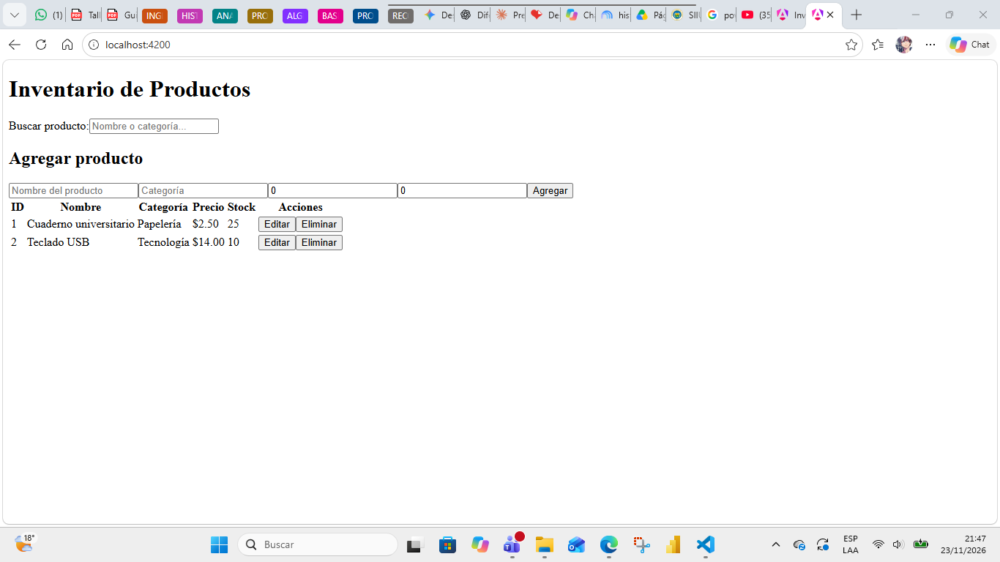

# Inventario con Angular
Programacion 1
Estudiante: Camila Sandoval
Objetivo: CRUD de productos usando arreglos de objetos.

## Ejecutar
npm install
ng serve

## Funciones
Agregar, listar, editar, eliminar y buscar productos.

## Evidencias

