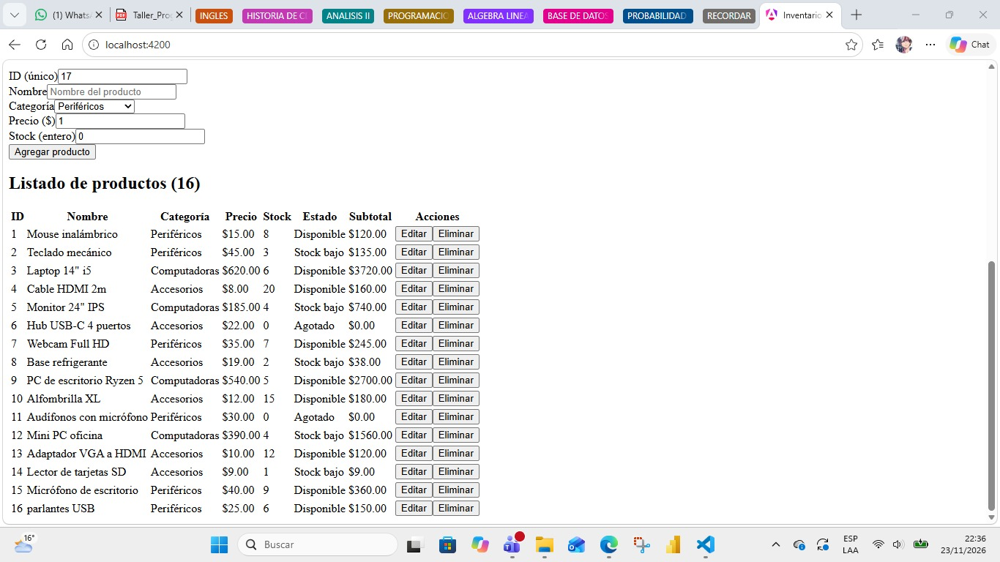
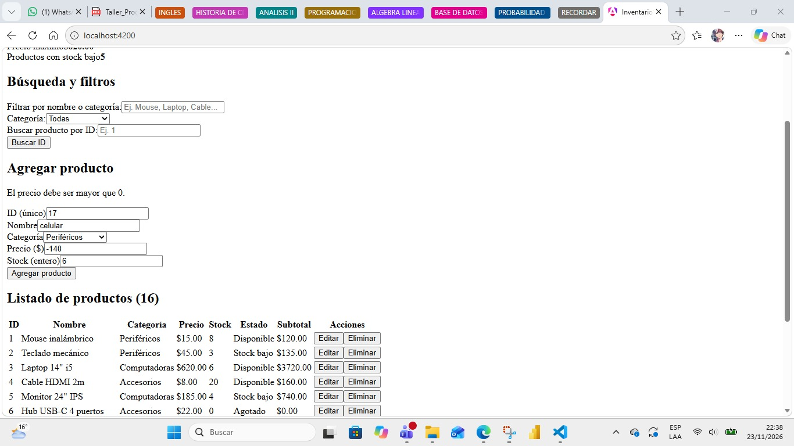
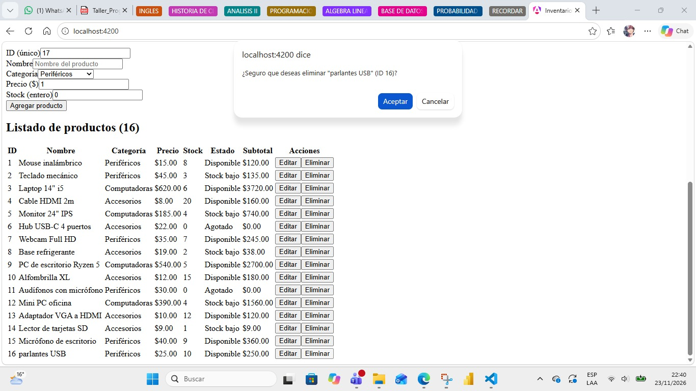
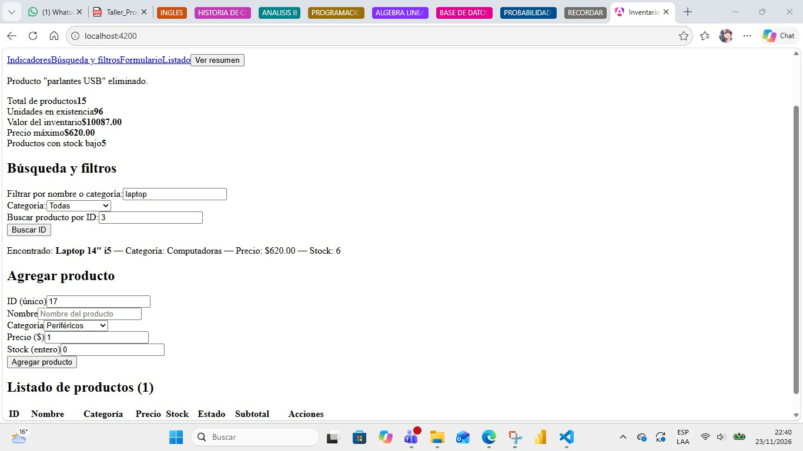

# Inventario de Productos con Angular

* **Asignatura:** Programación 1
* **Estudiante:** Camila Sandoval
* **Descripción:** Aplicación web en Angular para gestionar un inventario de productos (15 productos iniciales) aplicando variables, objetos, arreglos, funciones, ciclos (`@for`), condicionales (`@if`), eventos, validaciones, búsqueda, filtros y cálculos de indicadores
## Requisitos
* Node.js y npm
* Angular CLI

## Instalación y ejecución
```bash
npm install
ng serve```









